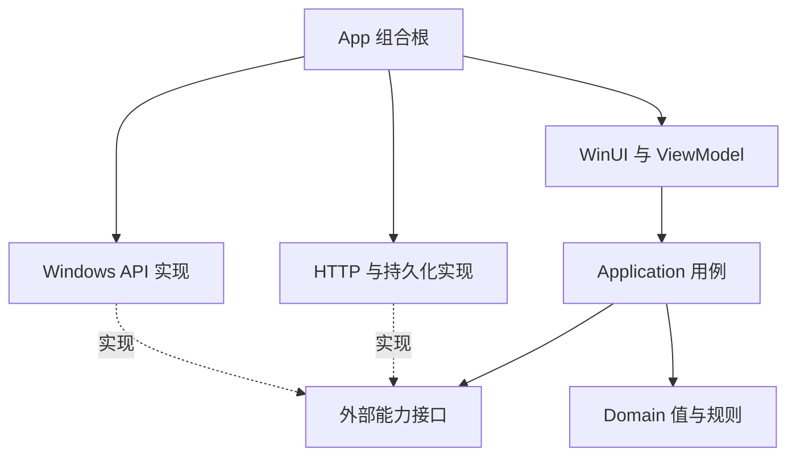

# Windows 架构与行为合同

状态：规范性设计，待实现。源事实见 [SOURCE_BASELINE](SOURCE_BASELINE.md)，产品范围见 [FEATURE_PARITY](FEATURE_PARITY.md)。

## 1. 设计原则

- 用模块清楚的原生桌面应用承载客户端，实行单一业务状态写入者；Windows 系统 provider 可使用独立激活入口或进程，远程 Go 监控独立部署。
- 复用协议、测试向量、业务语义和服务端；客户端以 C# 实现并经过行为对照。
- 每类状态一个所有者，外部结果只有经过连接/凭据/操作身份验证后才能发布。
- UI 负责呈现与命令；业务流程、HTTP、持久化和系统 API 分离。
- 数据模型按层区分：Wire DTO、领域值、数据库记录、UI 投影不能任意互传。
- 所有平台替代必须保留可观察的用户价值，并在矩阵中留下验收结果。

## 2. 建议目录与项目

| 项目/路径 | 编译边界 | 主要责任 |
| --- | --- | --- |
| src/CPAQuota.Domain | 纯 net10.0 | 账号身份、额度、CAP 窗口、聊天/监控状态、纯解析与接续规则 |
| src/CPAQuota.Application | 纯 net10.0 | 用例、状态容器、协调器、外部接口、错误语义、取消/代次 |
| src/CPAQuota.Infrastructure | 以纯 .NET 为主 | HTTP/provider、SQLite、附件、迁移、索引；Windows API 通过端口注入 |
| src/CPAQuota.Windows | Windows 目标 | DPAPI、AppInstance、通知、托盘、窗口激活、小组件、文件选择与图片处理 |
| src/CPAQuota.App | WinUI 3 | 页面、ViewModel、设计资源、导航、组合根 |
| tests/ | 按对应模块分组 | 纯逻辑、合同、故障、原生 UI、安装、基准 |
| contracts/upstream/ | 固定来源 | 精确 SHA 的原始合同、来源清单、许可；不在原位改动 |
| contracts/windows/ | 本项目新增 | 行为扩展、平台转换、故障与流式向量 |
| tools/ | 可复现入口 | 构建、验证、打包、证据与有界基准 |

仅在明确的独立性/编译收益出现后再拆更多程序集。聊天代码先按职责拆类和目录；不能把同一个大类拆成多个 partial 文件后宣称边界已经完成。

### 依赖图

App 组合根唯一负责实际实现装配。领域层不得引用 WinUI/DispatcherQueue/SqliteConnection/HttpClient/DPAPI；ViewModel 不直接处理密钥和网络响应。后台业务生命周期不依赖某个页面是否仍显示。

## 3. 主要接口合同

具体签名由 WP-003 固化，下面的责任不能漂移。

| 接口/协调器 | 合同 |
| --- | --- |
| ConnectionCoordinator | 候选验证、凭据提交/回滚、接受连接、epoch 切换；不在输入框变化时落盘 |
| ICpaGateway | inventory 与受限额度读取；调用携带有效会话身份，返回安全错误与领域结果 |
| IRateCoordinator | 同一管理作用域共享并发预算与冷却；force 不能绕过保护 |
| ICapGateway / CapWorkspaceCoordinator | 每个资源独立状态、窗口和重试，范围选择与发请求分离 |
| ISecretStore | 区分 missing、found、unavailable；写入/删除结果可失败，不得明文回退 |
| IChatEngine | IAsyncEnumerable<ChatEvent>；累计快照/usage/推理结果及终态规则明确 |
| ChatSessionCoordinator | server binding、credentialRevision、模型目录和跨服务发送授权 |
| ChatGenerationCoordinator | 单次 attempt 所有权、取消、兼容回退、状态发布、checkpoint 与终态 |
| IConversationRepository | 摘要/分页/搜索、事务、版本、写入排序、删除保护 |
| IAttachmentStore | 外置附件、哈希/引用、安全路径、缩略图和有界缓存 |
| IMonitoringGateway | 明确区分 v1 兼容读取/停止与 v2 通用订阅，不伪造 Apple 凭据 |
| IDesktopNotificationService | 固定文案+不透明定位ID，权限/能力结果清楚，不等同远端监控 |
| IWidgetSnapshotPublisher | 默认关闭共享、最小化快照、所有实例清理、发布代次检查 |
| IClock / IDelayScheduler | UTC 墙钟与单调时钟分开，方便边界和暂停恢复测试 |

密钥通过短生命周期请求装配获取，不能进入普通 UiState、序列化会话、日志或跨进程通知载荷。接口中的“已取消”只表示本地操作失效，不证明服务端未执行。

## 4. 状态组织

### 4.1 连接与资源身份

每个请求或生成操作记录：ConnectionEpoch、CredentialRevision、OperationId，以及适用的 QueryKey、ConversationId、AttemptId。资源发布前验证全部有关维度。取消 token 负责请求取消，身份验证负责拒绝无法及时停止的旧结果。

账号缓存身份包括源端定义的 id、authIndex、provider、codexAccountID 及服务器绑定；显示名不是身份。保留 WireDecoding 的精确整数规则。CAP sequence 的 UInt64 范围与账号身份的 JSON 安全整数边界不能混用。

### 4.2 资源状态

额度按账号独立更新；CAP initial/trends/groups/costs 各有自己的状态。状态应能同时表达：

- 当前数据及其查询窗口。
- observedAt、fetchedAt 和是否旧结果。
- 本次加载与取消能力。
- 本次错误和可重试时间。
- 部分/截断/未验证完整性标志。

成功资源不因其他资源失败被清空。界面错误消息由类型映射生成；失败不能把旧数据的时间戳刷新为当前时间。

### 4.3 连接事务

候选草稿 → 验证 inventory → 构造隔离的 CAP/聊天 candidate → 准备新秘密引用与提交意图 → 持久提交 active 指针 → 发布 accepted session → 渐进读取额度 → 清理旧引用。

事务阶段固定为 prepared → durableCommitted → published → cleanup。准备阶段只创建隔离候选，不得调用活动聊天工作区的 bind、取消旧 attempt、清除旧临时 key/能力缓存或删除旧秘密。候选验证、保存失败或提交前取消，必须保留旧 accepted session、聊天工作区及其临时 key。移植源测试 [failedCandidateConnectionPreservesAcceptedChatWorkspaceAndEphemeralKey](https://github.com/rinmashiro0529/cpa-quota-ios/blob/80beea9ed251a628307825cba99290b5f246575b/Tests/CPAQuotaKitTests/ChatSessionBindingTests.swift)。

秘密存储与数据库不具备天然跨资源事务；采用 intent/revision 与可恢复提交记录，不能宣称多个文件同时原子落盘。新秘密先安全持久化，active 指针的持久提交是接受连接的线性化点。此前取消先使候选操作失效，再取消网络并回滚候选写入；此后取消不能将已提交状态伪装为未发生，也不得删除 active 指针引用的新 key，必须完成发布或交由启动恢复协调。单一状态所有者在发布阶段切换活动上下文、失效旧连接代次并按明确定义处理旧生成。旧秘密仅在新状态已提交且无合法引用后清理，清理失败可重试且不能推翻已成功连接。

恢复程序逐阶段处理“秘密已写但指针未提交”“指针已提交但UI未发布”“旧引用清理未完”，可重复执行。取消只控制本地接受/发布边界，不证明远端请求或副作用已经撤销。

## 5. 不变量登记

| ID | 不变量 | 必测反例 |
| --- | --- | --- |
| INV-001 | 已接受连接只能经成功事务替换 | A迟到结果覆盖B；保存失败后新连接显示成功 |
| INV-002 | 取消和代次隔离并存 | 取消不及时、窗口已关闭仍弹出成功 |
| INV-003 | inventory先接受，额度渐进发布 | 最慢账号阻塞所有账号展示 |
| INV-004 | 账号凭据身份变化使旧缓存失效 | 同显示名换账号后显示原额度 |
| INV-005 | 管理请求共享并发3与认证/冷却状态 | 换页面/点force绕过429或熔断 |
| INV-006 | CAP四资源独立且保留原查询窗口 | 错误重试混入新窗口，成功区被清空 |
| INV-007 | 未知/不支持/无限/零/旧值/部分不同 | 缺字段变0，采样结果伪装全量 |
| INV-008 | UTC月语义、分钟对齐和旧编码不变 | 月按30天；本地DST改变绝对范围 |
| INV-009 | 管理key、推理key、搜索key和监控token分离 | 共享Authorization导致跨域泄漏 |
| INV-010 | 生成可见输出/usage后无透明重试 | 两次答案拼接、重复计费、EOF假完成 |
| INV-011 | 删除/替换后迟到写入不复活数据 | 后台标题或checkpoint重建已删会话 |
| INV-012 | 冷启动与终态落盘诚实 | streaming遗留被显示完成，失败保存丢内容 |
| INV-013 | 跨服务发送确认绑定目标及凭据版本 | 旧确认被重用，先截断历史再拒绝 |
| INV-014 | 本地停止、服务端停止、系统展示不同 | 关通知即宣称远端已停止 |
| INV-015 | v1墓碑不自动回收 | 延迟POST复活已取消会话 |
| INV-016 | 预览不能获得宿主秘密或网络能力 | HTML读取文件、弹窗、下载、脚本桥接 |
| INV-017 | 小组件共享默认关闭且撤销可见 | 关闭后旧快照/迟到刷新仍泄漏 |
| INV-018 | 当前证据绑定精确候选版本 | 将别的SHA、历史截图、未运行写成通过 |

源依据：[核心目录](https://github.com/rinmashiro0529/cpa-quota-ios/tree/80beea9ed251a628307825cba99290b5f246575b/Sources/CPAQuotaKit)、[Session](https://github.com/rinmashiro0529/cpa-quota-ios/blob/80beea9ed251a628307825cba99290b5f246575b/Sources/CPAQuotaUI/CPAQuotaSession.swift)、[聊天测试](https://github.com/rinmashiro0529/cpa-quota-ios/blob/80beea9ed251a628307825cba99290b5f246575b/Tests/CPAQuotaKitTests/ChatWorkspaceModelTests.swift)、[监控合同](https://github.com/rinmashiro0529/cpa-quota-ios/blob/80beea9ed251a628307825cba99290b5f246575b/docs/MONITOR_SERVICE.md)。

## 6. 网络边界

### 6.1 传输配置

每种用途使用明确的客户端配置与作用域：管理、CAP匿名读取、聊天生成、搜索、监控。禁止把全局 DefaultRequestHeaders.Authorization 复用于任意地址。每次请求从已验证 endpoint 组装路径并附加本次凭据。

CPA/CAP沿用已知核心边界：HTTPS；拒绝 URL 用户信息、query/fragment、反斜线、点路径、编码路径分隔；保留反代前缀；不自动重定向；不使用 Cookie 或隐式凭据；响应默认4MiB、超时75秒的源合同以各接口具体预算为准。

采用 ResponseHeadersRead 后自行累计实际读取字节和控制正文读取超时。Content-Length 校验不能替代累计限制。压缩解码后的体积也受限；不先读完整字符串再判断大小。

聊天连接、首响应、读空闲、整体操作分别设有界超时。具体值由当前源配置与 WP-011 合同测量确定并进入配置，不能无限等待；长推理的正常无文本阶段不能直接等同断流。

### 6.2 重试与副作用

- 读取：有界退避、尊重 Retry-After、取消及时；401/403 不盲目重试。
- POST 包装额度读取：依业务语义定义，不能因为HTTP动词统一禁止或统一重试。
- 生成：取消、超时、断流可能已有服务端执行；没有已验证幂等能力时不透明重放。兼容错误回退沿用源规则。
- 监控控制：以同一操作ID/相同载荷对账，结果不明保持 unknown，禁止换ID自动再创建。
- 纯界面选择/筛选不产生意外网络请求。
- 健康检查不发送付费模型生成。自动化仅使用本地合成服务。

## 7. 线程、窗口与任务生命周期

UI更新统一通过DispatcherQueue适配器；Domain/Application不持有Window、HWND或控件。业务事件先由单一状态所有者处理，再发布只读投影。

Widgets 的 [IWidgetProvider](https://learn.microsoft.com/en-us/windows/windows-app-sdk/api/winrt/microsoft.windows.widgets.providers.iwidgetprovider) 是 out-of-process COM server，系统可独立激活和释放它。是否共用可执行文件由 WP-002 验证，但入口必须先分类 COM/Widgets/推送/通知激活，再执行适用的 AppInstance 单实例路由；不能因主窗口已运行就让 provider 入口直接退出。provider 只读去敏、不可变的版本化快照或调用受控 IPC，不成为第二个聊天数据库写入者，不持有管理/推理秘密。主程序退出、provider 重启和隐私撤销均有独立验收。

每个聊天会话的生成/保存所有权独立于其页面。窗口隐藏、导航和关闭命令含义明确。新窗口复用同一业务状态，不启动重复生成；正式多窗口功能由独立任务验证。

异步队列有界。允许合并纯展示快照，但不能丢弃usage、错误、终态或持久化意图。流式正文用增量缓冲更新，避免每字符复制全部历史或重算整篇Markdown。

睡眠恢复先核对身份、截止时间与持久状态，再有限刷新；不回放所有错过的定时任务。停止操作不被普通刷新冷却阻挡。

## 8. 端到端故障设计

| 故障 | 可见结果与恢复 |
| --- | --- |
| 网络离线或TLS失败 | 安全错误，保留旧数据；不关闭证书验证 |
| DPAPI不可解密/写失败 | 凭据不可用，提供重新输入；不覆盖原记录或明文回退 |
| 数据库迁移失败 | 保留原文件和备份，进入恢复入口；不破坏性重建 |
| 磁盘满 | 标未保存，停止继续制造无界内容；恢复后可重试保存 |
| 附件缺失/损坏 | 显示具体占位，保留消息文本；不把整个历史清空 |
| WebView2异常 | 结束预览，聊天继续可用；不改为不安全预览 |
| 系统通知权限不可用 | 应用内状态保留；准确提示投递能力 |
| 进程被强制终止 | 从上次成功checkpoint恢复为interrupted；不自动重发 |
| 监控写入结果未知 | 保留操作身份并对账；不显示已完成 |

更多存储、预览与恢复设计见 [CHAT_AND_DATA](CHAT_AND_DATA.md)。平台部署见 [PLATFORM_AND_RELEASE](PLATFORM_AND_RELEASE.md)。

## 9. 演进与合同变更

源基线变动通过source-lock更新和差异审查进入。原始fixture保留来源SHA，新增Windows fixture须标版本。修复源端已确认缺陷时新增差异条目和两端预期，不能为了“完全复刻”复制已知数据损坏行为。

当前不引入消息总线、微服务化客户端、运行时插件系统或共享Swift/C++核心。存在实测需求时再通过ADR评估。

